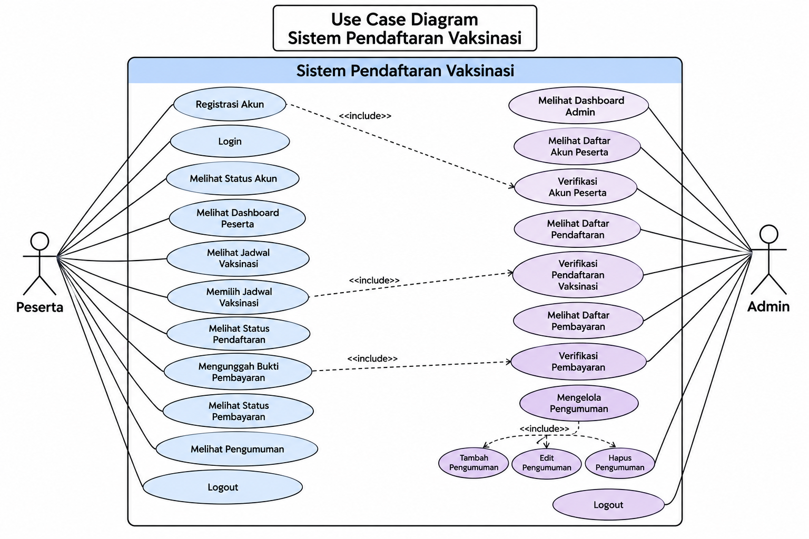

# VaksinSehat

VaksinSehat adalah aplikasi pendaftaran vaksinasi yang mengelola perjalanan peserta dari pembuatan akun, pemilihan jadwal, verifikasi, hingga pembayaran. Admin mengelola persetujuan peserta, pendaftaran, pembayaran, dan pengumuman.

## Spesifikasi dan dependensi

### Persyaratan sistem

| Komponen | Persyaratan |
| --- | --- |
| PHP | 8.2 atau lebih baru |
| Composer | Composer 2.x |
| Node.js | `^20.19.0` atau `>=22.12.0` (persyaratan Vite 7) |
| npm | npm yang disertakan dengan Node.js |
| Database | SQLite (konfigurasi awal) atau MySQL dengan driver PDO yang sesuai |
| Browser | Versi terbaru Chrome, Firefox, Edge, atau Safari |

Versi yang telah diverifikasi pada lingkungan pengembangan: PHP 8.2.12, Laravel Framework 12.74.0, Node.js 24.15.0, npm 11.12.1, Vite 7.3.8, Tailwind CSS 4.3.5, dan Pest 3.8.7. Rentang versi dan dependensi proyek didefinisikan di `composer.json`, `composer.lock`, `package.json`, dan `package-lock.json`.

### Dependensi utama

- **Backend:** Laravel Framework `^12.0`, PHP `^8.2`, dan Laravel Tinker `^2.10.1`.
- **Frontend/build:** Vite `^7.0.7`, Laravel Vite Plugin `^2.0.0`, Tailwind CSS `^4.0.0`, `@tailwindcss/vite` `^4.0.0`, Axios `^1.11.0`, dan Concurrently `^9.0.1`.
- **Pengembangan dan pengujian:** Pest `^3.8`, Pest Laravel Plugin `^3.2`, Laravel Pint `^1.24`, Faker `^1.23`, Mockery `^1.6`, Laravel Boost, Sail, Pail, dan Collision.
- **Integrasi opsional:** Gemini API dengan Google Search grounding untuk pencarian berita kesehatan harian. Aplikasi menggunakan HTTP client bawaan Laravel; tidak memerlukan SDK Gemini tambahan.

## Diagram kasus penggunaan

Diagram berikut menunjukkan interaksi peserta dan admin pada sistem pendaftaran vaksinasi.



## Fitur dan kegunaannya

### Informasi publik

- Halaman utama `/` menyediakan satu tombol masuk menuju halaman `/login`. Pada halaman login, pengguna memilih peran admin atau peserta; pendaftaran akun peserta tersedia melalui `/register`.
- Halaman `/jadwal` dapat dibuka tanpa login. Pengunjung dapat melihat tanggal, jam, kuota, dan sisa kuota vaksinasi, tetapi tidak dapat mendaftar dari halaman ini.
- Rute lama `/login/admin` dan `/login/peserta` tetap tersedia sebagai pengalihan ke halaman login bersama.
- Beranda menampilkan panduan umum persiapan vaksinasi dan tiga pengumuman terbaru yang dapat dibaca publik.
- Beranda sebelum login juga menampilkan carousel berita imunisasi terbaru dengan ringkasan, tanggal, dan tautan sumber.
- Kuota dihitung dari pendaftaran yang masih berstatus `pending` atau `diterima`. Pendaftaran yang ditolak atau kedaluwarsa tidak lagi menggunakan kuota.

### Akun dan akses

- Peserta membuat akun dengan nama, email, kata sandi, NIK, nomor telepon, dan alamat.
- Akun peserta baru berstatus menunggu verifikasi. Admin menerima atau menolak akun sebelum peserta dapat menggunakan fitur pendaftaran.
- Admin dan peserta menggunakan satu halaman `/login` lalu memilih peran pada formulir. Pemeriksaan peran melindungi halaman masing-masing.
- Akun yang belum disetujui diarahkan ke halaman status akun. Peserta yang belum login atau belum disetujui tidak dapat menggunakan fitur pendaftaran dan pembayaran.

### Pendaftaran jadwal

- Peserta yang akunnya telah disetujui memilih jadwal yang masih memiliki kuota.
- Jadwal baru dibuat otomatis setiap hari pukul 00.05 waktu Jakarta jika tanggal hari tersebut belum memiliki jadwal. Slot bergantian pukul 08.00–12.00 dan 09.00–13.00, masing-masing berkuota 50, termasuk akhir pekan.
- Perintah dapat dijalankan manual dengan `php artisan vaksinasi:generate-daily-schedule`. Jika jadwal hari ini sudah ada, perintah tidak membuat duplikat atau mengubah jadwal yang ada.
- Jadwal lampau, kuota penuh, dan pendaftaran ganda ditolak oleh server.
- Pendaftaran baru berstatus `pending`. Pendaftaran tersebut menggunakan kuota sambil menunggu keputusan admin.
- Admin dapat melihat data peserta dan jadwal, kemudian menerima atau menolak pendaftaran. Keputusan dan identitas verifikator disimpan.

### Pembayaran

- Form pembayaran tersedia setelah pendaftaran jadwal diterima admin.
- Biaya ditetapkan server melalui `VAKSINASI_BIAYA` (nilai proyek saat ini Rp500.000); peserta tidak menentukan nominal sendiri.
- Setelah pendaftaran diterima, halaman pembayaran menampilkan nomor rekening simulasi yang stabil sebagai contoh alur transfer. Nomor tersebut fiktif dan bukan untuk transaksi nyata.
- Peserta mengunggah bukti pembayaran berformat JPG, JPEG, PNG, atau PDF dengan ukuran maksimum 5 MB. Bukti disimpan pada penyimpanan privat dan hanya admin berwenang yang dapat mengunduhnya.
- Admin menerima atau menolak bukti pembayaran. Peserta dapat melihat status dan alasan penolakan.
- Jika bukti ditolak, peserta memiliki waktu satu jam sejak penolakan admin untuk mengunggah ulang. Batas waktu ditampilkan menurut zona waktu perangkat, sementara perhitungan tenggat dilakukan server.
- Jika tidak ada unggahan ulang sebelum batas waktu, pendaftaran lama menjadi `kedaluwarsa`. Riwayat dan bukti yang ditolak tetap tersimpan, kuota dilepaskan, dan peserta harus membuat pendaftaran baru. Peserta dapat memilih jadwal yang sama kembali bila kuotanya masih tersedia.

### Pengumuman dan dashboard

- Admin dapat membuat, mengubah, dan menghapus pengumuman.
- Peserta dapat melihat daftar pengumuman yang diterbitkan.
- Dashboard admin dan peserta menampilkan ringkasan pengumuman terbaru agar informasi penting mudah ditemukan.
- Berita di dashboard peserta dapat digeser dengan kontrol sebelumnya/berikutnya atau scroll horizontal.
- Beranda publik dan dashboard peserta menampilkan carousel berita imunisasi bersumber dengan tanggal dan tautan. Berita baru dicari setiap hari menggunakan Gemini dan Google Search grounding, hanya disimpan bila topiknya relevan serta URL-nya terverifikasi; konten tetap bersifat edukatif, bukan diagnosis.
- Sapaan dashboard admin dan peserta menyesuaikan waktu lokal perangkat dan menampilkan tanggal hari ini.

## Alur kerja aplikasi

1. **Pengunjung melihat jadwal** — pengunjung dapat memeriksa kuota tanpa akun, tetapi tidak dapat melakukan pendaftaran.
2. **Peserta mendaftar akun** — akun baru dibuat dengan status menunggu verifikasi.
3. **Admin memverifikasi akun** — admin menerima atau menolak akun. Peserta yang diterima dapat masuk ke fitur peserta.
4. **Peserta memilih jadwal** — sistem memeriksa tanggal, kuota, dan pendaftaran ganda, lalu menyimpan pendaftaran berstatus menunggu.
5. **Admin memverifikasi pendaftaran** — admin menerima atau menolak pilihan jadwal dan sistem mencatat keputusan serta verifikator.
6. **Peserta mengirim pembayaran** — setelah pendaftaran diterima, peserta membayar sesuai biaya yang ditetapkan dan mengunggah bukti.
7. **Admin memverifikasi pembayaran** — pembayaran diterima atau ditolak. Jika ditolak, peserta dapat mengunggah ulang dalam satu jam.
8. **Sistem memulihkan kuota bila tenggat terlewati** — pendaftaran kedaluwarsa dan kuotanya tersedia kembali; peserta perlu mendaftar ulang.
9. **Peserta membaca pengumuman** — peserta melihat informasi terbaru melalui halaman pengumuman atau ringkasan di dashboard.

## Peran komponen aplikasi

- `routes/web.php` mendefinisikan URL publik, autentikasi, peserta, dan admin.
- `app/Http/Controllers/` menjalankan proses pendaftaran, pembayaran, verifikasi, dan pengumuman.
- `app/Models/` mewakili data akun, profil, jadwal, pendaftaran, pembayaran, serta relasinya.
- Middleware `role` dan `akun.diterima` membatasi fitur berdasarkan peran dan status akun.
- `database/migrations/` membangun struktur tabel dan indeks. Riwayat pendaftaran lama disimpan agar peserta dapat mendaftar kembali tanpa menghapus catatan sebelumnya.
- `config/vaksinasi.php` membaca nominal biaya dari `VAKSINASI_BIAYA`.
- `app/Models/BeritaKesehatan.php` dan tabel `berita_kesehatan` menyimpan berita harian terverifikasi beserta atribusi Google Search.
- `app/Console/Commands/FetchDailyHealthNews.php` mencari maksimal satu berita vaksinasi/imunisasi per hari menggunakan Gemini; berita hanya ditampilkan setelah validasi topik, tanggal, dan sumber.
- `app/Console/Commands/ExpireRejectedPaymentRegistrations.php` mengubah pendaftaran yang melewati tenggat menjadi kedaluwarsa. Pengecekan juga dilakukan saat halaman jadwal atau pembayaran dibuka maupun saat peserta mencoba mengunggah ulang.
- `app/Console/Commands/GenerateDailyVaksinasiSchedule.php` menambahkan satu slot jadwal untuk tanggal hari ini bila belum tersedia.

## Instalasi dan konfigurasi

1. Pastikan PHP, Composer, Node.js, npm, dan database yang dipilih sudah terpasang. Clone repository dari GitHub, lalu buka direktori proyek.

2. Pasang dependensi. `npm ci` menggunakan lockfile agar versi paket frontend konsisten:

   ```sh
   composer install
   npm ci
   ```

3. Buat file konfigurasi lokal dari `.env.example`:

   ```sh
   cp .env.example .env
   ```

   Pada Windows PowerShell, gunakan:

   ```powershell
   Copy-Item .env.example .env
   ```

4. Buat kunci aplikasi:

   ```sh
   php artisan key:generate
   ```

5. Atur koneksi database dan biaya di `.env`. Konfigurasi awal menggunakan SQLite dan file database `database/database.sqlite`; jika memilih MySQL, sesuaikan `DB_CONNECTION`, host, nama database, username, dan password.

   ```dotenv
   DB_CONNECTION=sqlite
   VAKSINASI_BIAYA=500000
   ```

6. Jalankan migrasi dan seeder:

   ```sh
   php artisan migrate --seed
   ```

   Seeder menambahkan akun admin awal, contoh jadwal vaksinasi, dan berita edukasi awal. Akun admin seeder ditujukan untuk pengembangan lokal; perbarui kredensialnya sebelum deployment.

7. Bangun aset frontend dan jalankan aplikasi:

   ```sh
   npm run build
   composer run dev
   ```

   `composer run dev` menjalankan web server, Vite, worker antrean, dan Laravel Scheduler. Scheduler memproses pendaftaran kedaluwarsa setiap menit, membuat jadwal pukul 00.05 WIB, serta mencari berita kesehatan pukul 08.00 WIB.

### Konfigurasi berita otomatis (opsional)

Untuk mengaktifkan pencarian berita, buat API key Gemini melalui Google AI Studio lalu isi variabel berikut di `.env`:

```dotenv
GEMINI_API_KEY=isi_api_key_lokal
GEMINI_MODEL=gemini-3.8-flash
```

Jalankan pencarian secara manual dengan `php artisan berita:ambil-harian`. Scheduler menjalankannya setiap hari pukul 08.00 WIB. Perintah menyimpan maksimal satu berita per tanggal Jakarta, hanya jika ada berita baru yang relevan dan URL sumber terverifikasi melalui Google Search grounding. Saran Penelusuran Google juga ditampilkan mengikuti ketentuan grounding. Penggunaan API tunduk pada kuota dan kemungkinan biaya dari Google. Jangan commit API key atau file `.env` ke repository.

Untuk production, jalankan Laravel Scheduler melalui cron atau penjadwal tugas sistem operasi sesuai panduan resmi Laravel.

## Pengujian

Jalankan seluruh pengujian otomatis dengan:

```sh
php artisan test --compact
```

Pengujian fitur mencakup autentikasi dan verifikasi akun, kuota dan pendaftaran ganda, verifikasi pendaftaran, unggah serta verifikasi pembayaran, tenggat unggah ulang, pemulihan kuota, berita harian, pengumuman, dan pembatasan akses.
